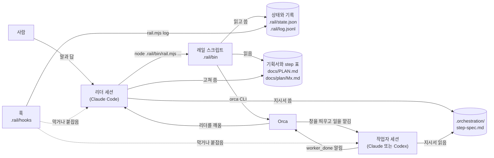
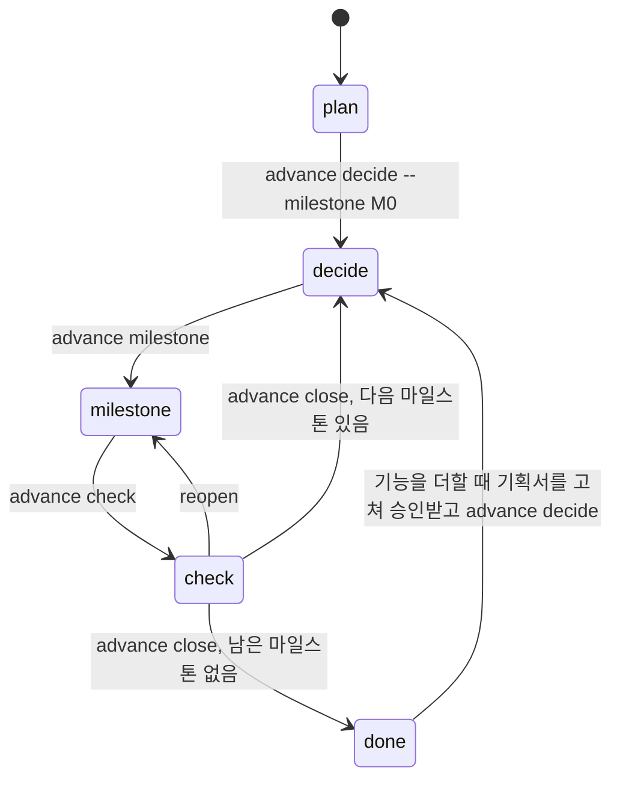

# 레일은 어떻게 돌아가나

이 문서는 레일의 속을 설명합니다. 설치하고 쓰는 법은 [README](README.md)에 있습니다. 여기 적은 것은 모두 이 저장소의 코드(`scripts/`, `hooks/`, `skills/`, `templates/`)를 직접 읽고 확인한 사실이고, 코드로 확인하지 못한 것은 "코드에서 확인 못 함"이라고 적었습니다.

## 목차

0. [쉬운 말 요약](#0-쉬운-말-요약)
1. [전체 그림](#1-전체-그림)
2. [한 바퀴 따라가기](#2-한-바퀴-따라가기)
3. [판정은 누가 하나](#3-판정은-누가-하나)
4. [모듈 지도](#4-모듈-지도)
5. [상태와 기록](#5-상태와-기록)
6. [훅 다섯 개](#6-훅-다섯-개)
7. [자율 모드 고리](#7-자율-모드-고리)
8. [설치와 업데이트가 하는 일](#8-설치와-업데이트가-하는-일)
9. [맥과 Windows 차이](#9-맥과-windows-차이)
10. [크기](#10-크기)
11. [코드가 보지 않는 것](#11-코드가-보지-않는-것)

---

## 0. 쉬운 말 요약

레일은 제품 레포 안에 깔리는 작은 Node 스크립트 묶음(`.rail/bin/rail.mjs`)과, Claude Code 가 정해진 순간에 저절로 부르는 훅 다섯 개(`.rail/hooks/` 의 스크립트와 `rail.mjs status --hook`), 그리고 AI 에게 판단 요령을 알려 주는 스킬 네 개(`.claude/skills/rail*/`)로 이루어져 있습니다. 사람과 대화하는 Claude Code 세션(리더)은 `/rail` 을 받으면 스크립트에게 "지금 어디이고 다음에 무엇을 하나"를 묻고, 스크립트가 돌려준 "다음 할 일" 문장을 그대로 따릅니다. 실제 코드는 리더가 Orca 창에 띄운 다른 세션(작업자)이 만들고, 만든 것은 또 다른 작업자가 확인하고, 마지막에는 실제 화면을 눌러 본 결과를 사람이 직접 보고 판정합니다. 단계를 넘어가도 되는지, step 을 끝내도 되는지는 스크립트가 상태 파일(`.rail/state.json`)과 문서를 읽고 정하며, 막히면 종료 코드 1 과 "빠진 것" 목록을 냅니다. 모든 일은 사건 기록(`.rail/log.jsonl`)에 한 줄씩 남아서, 어떤 장치가 실제로 몇 번 막았는지 셀 수 있습니다.

**비유: 주방.** 주방장(리더)은 손님(사람)의 주문을 받아 주문서(지시서, `.orchestration/<step>-spec.md`)를 쓰고, 보조 요리사(작업자)에게 한 접시씩 맡깁니다. 다른 보조 요리사가 맛을 보고(확인 작업자), 벽에 붙은 규칙(훅)은 누가 요리하든 "남의 레시피 카드(시험 파일)를 고치지 마라", "설거지 전에 시식(검사 명령)을 통과하라"를 지키게 합니다. 칠판(`state.json`)에는 지금 몇 번째 코스인지가 적혀 있고, 주방 일지(`log.jsonl`)에는 모든 일이 적힙니다. 코스가 끝나면 시식 담당(리허설 작업자)이 실제로 차려 보고, 마지막으로 손님이 직접 먹어 보고 "됨/안 됨"을 말합니다(장면 판정). 주방장이 스스로 "맛있다"고 판정하지 못하게 하는 것이 이 주방의 핵심입니다.

## 1. 전체 그림

누가 누구를 부르는지입니다. 굵은 선은 명령을 부르는 흐름, 점선은 훅이 끼어드는 자리입니다.

단계(`state.json` 의 `stage`)는 다섯 개이고, 넘어가는 길은 `scripts/lib/gates.mjs` 의 `NEXT_OF` 표 하나로 정해져 있습니다.

`reopen` 은 관문이 아니라 장면 확인이 실패했을 때 쓰는 되돌림입니다(`scripts/lib/scene.mjs:cmdReopen`).

## 2. 한 바퀴 따라가기

명령은 모두 레포 맨 위에서 `node .rail/bin/rail.mjs <명령>` 으로 부릅니다. 아래 "명령" 칸은 그 뒤에 붙는 부분만 적었습니다.

| 순간 | 무슨 일이 일어나나 | 명령 | 읽고 쓰는 파일 | 끼어드는 훅 |
|---|---|---|---|---|
| 1. 설치 | 레일 파일을 복사하고 `.claude/settings.json` 에 훅 다섯 개와 허용 네 줄을 넣습니다(8절) | `rail-install` (`scripts/install.mjs:install`) | `.rail/bin/`, `.rail/hooks/`, `.claude/skills/rail*/`, 시작 틀, `.rail/installed.json` | 없음 |
| 2. 세션 열기 | 위치 세 줄(위치 / 기다리는 것 / 다음 할 일)을 AI 와 사람에게 보이고, 이 세션 번호를 리더로 적습니다 | `status --hook` (훅이 부름) | `state.json` 의 `leader_session`, `busy` | 세션 시작 |
| 3. `/rail` | 스킬 `rail` 이 `status --json` 출력을 프롬프트에 넣습니다. 리더는 그 `next` 문장을 그대로 하고, 판단이 필요하면 `skill` 칸이 가리키는 하위 스킬을 읽습니다 | `status --json` | `.claude/skills/rail/SKILL.md` | 없음 |
| 4. 인터뷰 | 단계 `plan`. 리더가 질문 하나를 기록하고 턴을 끝냅니다. 사람이 답하면 답을 그대로 남깁니다. 인터뷰 질문 수를 세고, 세 번째마다 되짚기를 하라고 출력합니다. 질문 수에 상한은 없습니다 | `ask "<질문>"`, `answer "<답>"` | `state.json` 의 `human_ask`, `interview.asked`; 사건 `human_ask`, `human_answer` | 마무리 검사는 열린 질문이 있으면 붙잡지 않습니다 |
| 5. 기획서 승인 | 리더가 `.rail/plan/template.md` 꼴로 `docs/PLAN.md` 를 씁니다. `status` 가 빠진 줄을 하나씩 알려 주고(`docs.mjs:sheetProblems`), 다 채우면 승인 질문을 하라고 합니다. 사람이 "맞음"이라고 하면 리더가 기획서 맨 위에 `승인: YYYY-MM-DD` 줄을 더합니다. 그다음 안내가 `CLAUDE.md` 빈칸(코드 지도 위의 띄어쓰기 든 `<…>` 수)과 `checkCommand`(지금 값을 보이고, 타입 검사·린터가 있으면 함께)를 한 번 짚은 뒤 다음 단계로 갑니다 | `ask "…" --kind approve`, `answer`, `advance decide --milestone M0` | `docs/PLAN.md`(승인의 원본은 이 `승인:` 줄 하나); `state.json` 의 `stage`, `milestone` | 없음 |
| 6. 착수 전 결정과 가정 시험 | 단계 `decide`. 이 마일스톤의 성공 장면들에 적힌 "착수 전" 번호(D-xx 결정, T-xx 시험)를 모읍니다. 결정은 후보를 보이고 사람에게 묻고, 사람이 고르면 리더가 기획서 그 줄을 `결정: 선택함 (…)` 꼴로 고칩니다. 봐야 아는 결정은 시제품(`proto`)을 붙입니다. 가정 시험은 `.rail/trial/template.md` 로 지시서를 쓰고 버리는 코드로 진짜 자료에 해 본 뒤 `시험: 통과 …` 꼴로 적습니다. 이 마일스톤의 장면이 아직 자리표시(제목에 `(예상)`, 자동 확인이 비었거나 `<…>`·"기획할 때 정한다" 꼴)면 먼저 그 마일스톤을 기획하라고 안내하고 시작을 막습니다. 앞 마일스톤을 닫을 때 자리표시였으면 채운 뒤에도 고친 기획서를 다시 승인받을 때까지 기획 안내가 남습니다. 다 풀리면 마일스톤을 시작합니다 | `ask … --kind decide`, `answer`, `proto start/record/card/pick`, `advance milestone` | `docs/PLAN.md` "결정과 시험", `docs/decisions/D-xx-*.md`, `.rail/trial/T-xx/`, `.rail/proto/`; `state.json` 의 `gates.plan_marks`(시작할 때 기획서에 있던 번호, 계획 밖 결정을 셀 기준) | 없음 |
| 7. step 표 | 단계 `milestone`. 리더가 지금 마일스톤의 `docs/plan/Mx.md` 를 씁니다(기본: 줄 하나 = 기능 하나, 마지막 줄은 "마지막 리뷰"). 자율 모드가 아니면 표를 보이고 "이대로 시작할까요?"를 묻습니다. 기획서의 `- 걸리는 시험: <파일>` 이 어느 줄의 "고쳐도 되는 파일" 안이면 질문에 그 step 의 시험 고치기 허락을 묶어 냅니다. 그 답에는 그때의 줄 목록(`steps`)이 함께 남습니다. 시작하면 상태 칸에 ⏳ 가 들어갑니다 | `ask … --kind approve`, `step-start M0-1` | `docs/plan/M0.md` 의 "상태" 칸; 사건 `step_start`, 자율이면 `auto_start` | 없음 |
| 8. 작업자(기능) | 리더가 `.orchestration/M0-1-spec.md` 를 씁니다. `worker start` 가 Orca 창을 고르고(리더 탭을 나누거나 새 탭. 나누기가 끝내 실패하면 그 사이 생긴 창을 닫고 새 탭으로 한 번 다시 띄웁니다. 새 탭이면 출력에 `[새 탭]` 줄을 내고, 리더가 주인에게 그 탭 이름을 전합니다), 그 창에 `claude --dangerously-skip-permissions …` 를 띄우고, Orca 에 지시서를 맡깁니다. 작업자 창이 "이 폴더를 믿습니까?" 화면에 멈추면 맡기지 않고 실패로 적습니다. 작업자가 끝나면 Orca 가 리더를 깨우고, 리더가 `worker done` 으로 보고를 읽고 그 창 하나만 닫습니다. `isolation` 이 `worktree` 면 작업자는 자기 git worktree 에서 일하고 `worker done` 이 main 에 합칩니다 | `worker start M0-1 --agent claude --role feature`, `worker done M0-1` | `.orchestration/`; 사건 `worker_start`, `worker_done`, `worker_closed` | 작업자 세션에도 같은 레포 설정의 훅(시험 잠금, 마무리 검사)이 걸립니다 |
| 9. 커밋 관문 | 리더가 검사 명령(`checkCommand`)이 통과하고 바뀐 파일이 그 줄의 "고쳐도 되는 파일" 안인지 봅니다. 그러면 커밋 정책대로 그 step 의 파일만 커밋합니다: 시작 틀의 `auto-local` 이면 묻지 않고 로컬 커밋(푸시 안 함), `ask` 면 사람에게 물은 뒤. 따로 남기는 기록은 없습니다 | `git add <그 step 의 파일>`, `git commit` | 없음 | 마무리 검사 훅이 같은 검사 명령을 돌려, 실패한 채로는 세션이 멈추지 못합니다 |
| 10. 확인 작업자 | 기능을 만들지 않은 새 작업자가 `.rail/check/template.md` 로 채운 지시서를 받아, 완료 기준을 어기는 경우를 찾습니다. 결과는 `.rail/check/M0-1.json`(`must`, `nice`), 재현 시험은 `.rail/check/M0-1/*.test.mjs` 입니다. 배포 안 됨·키 없음처럼 코드 밖 사정으로 볼 수 없는 기준은 `must` 가 아니고 `nice` 에 "배포 뒤 볼 것"으로 적습니다(틀의 한 줄). `must` 가 있으면 리더가 그 기록을 커밋해 잠근 뒤 고침 작업자 `M0-1-fix` 를 띄우고, 고침 작업자를 닫은 뒤 안내가 고친 코드의 커밋 관문을 짚습니다. 확인 step 안내는 만든 작업자 보고에 지도와 다른 구조가 있으면 코드 지도를 고쳐 기능 커밋에 넣으라는 한 줄을 붙입니다 | `worker start M0-1-check --role check`, `worker start M0-1-fix --role fix` | `.rail/check/` | 확인 결과 폴더는 점으로 시작해 `node --test` 가 저절로 돌리지 않으므로 마무리 검사를 막지 않습니다 |
| 11. step-done | 상태 칸을 `✅ 끝(날짜) <한 줄>` 로 씁니다. 기능 줄이면 확인 기록이 있어야 하고, `must` 가 있었으면 고침 작업자가 닫혀 있어야 합니다(`check.mjs:featureProblems`). 시험 줄이면 지금의 시험 파일을 기준선에 찍어 커밋 전이어도 잠급니다 | `step-done M0-1 --note "<한 줄>" [--commit <해시>]` | `docs/plan/M0.md`, `.rail/test-baseline.json`; 사건 `step_done` | 기준선이 생긴 뒤에는 시험 잠금이 기준선의 파일도 막습니다 |
| 12. 마지막 리뷰 | 표의 마지막 줄("마지막 리뷰")은 역할 `final-review` 로 읽히고, `codexRoles`(기본 `["final-review"]`)에 있으므로 Codex 로 띄우라고 안내합니다. `codex` 명령이 PATH 에 없으면 `worker start` 가 Claude 로 대신 띄우고 경고와 `codex_missing` 을 남깁니다 | `worker start Mx-N --agent codex --role final-review` | 지시서가 가리키는 `.rail/review/<step>.json` (코드는 읽지 않음, 11절). 기능이 아닌 줄의 작업자를 닫으면 안내가 다시 띄우라 하지 않고 커밋 관문·`step-done` 과 "리뷰 기록에 must 가 있으면 고침 줄을 더한다"를 냅니다 | 없음 |
| 13. 검증기와 장면 단계 | 모든 step 이 ✅ 이면, 검증기(`verify` 설정)가 있을 때 마지막 step 뒤에 `verify` 를 돌리라고 안내합니다. 그다음 장면 확인 단계로 갑니다 | `verify`, `advance check` | 사건 `verify_run` | 없음 |
| 14. 리허설 | 리더가 점검표 `.rail/rehearsal/Mx/checklist.md`(0번은 "지금 화면이 오늘 빌드인가")와 지시서를 쓰고 리허설 작업자를 띄웁니다. 작업자는 항목마다 스크린샷과 `result.json` 을 씁니다. 리더가 기록하면 통과 수가 상태에 남습니다. 자율 모드에서 실패가 모두 기계로 가릴 수 있는 항목이면 사람에게 묻기 전에 마일스톤마다 두 번까지 스스로 고칩니다 | `worker start Mx-rehearsal --role rehearsal`, `rehearsal-record Mx`, `reopen --self-fix` | `.rail/rehearsal/Mx/`; `state.json` 의 `gates.rehearsed` | 없음 |
| 15. 장면 판정 | 스크립트가 질문 문구를 만듭니다(리허설 숫자와 답 예시가 듭니다). 사람의 답에서 "됨/안 됨"과 "본 것"을 스크립트가 가르고, 둘 중 하나가 빠지면 한 번 더 물으라고 합니다. "안 됨"이면 `reopen` 으로 step 단계로 돌아가 고칠 줄을 더합니다 | `ask --scene`, `answer "됨. 본 것: …"`, `scene Mx --result pass\|fail --note "…"`, `reopen` | `state.json` 의 `gates.scene_checked`; 사건 `scene_check` | 없음 |
| 16. 닫기 | 리더가 기획서 "살아 있는 세 줄"을 이 마일스톤 기준으로 고치고(장면 확인으로 갈 때 남긴 지문과 같으면 안내가 짚습니다. 계획 밖 결정 수는 스크립트가 센 값을 적으라고 안내), 이번 마일스톤에서 정한 결정(착수 전 D·T, 계획 밖 결정, `결정: 바뀜` 인 옛 결정 가운데 아직 `docs/decisions/` 를 가리키지 않는 줄)을 접고(후보 줄과 긴 설명을 `docs/decisions/<번호>-<짧은 이름>.md` 에 글자 그대로 옮기고, 기획서 줄에는 번호·상태 말·고른 것·다시 볼 조건·상세 파일만. 시제품 카드가 있으면 그 끝에 덧붙임), `CLAUDE.md` 코드 지도를 이번 코드에 맞게 고칩니다(틀 문구면 만듭니다). 같은 안내가 `CLAUDE.md` 에는 지금 사실만 한 번 적고 명령 옵션 설명은 스크립트 도움말로 옮기며, 레일이 고쳐서 필요 없어진 배운 규칙과 기계 검사로 바뀐 배운 규칙은 지우라고 하고, 크기 줄(기획서 성공 장면·결정과 시험·화면·살아 있는 세 줄과 `CLAUDE.md` 의 KB, 막지 않음)을 보입니다. 기준(`CLAUDE.md` 6KB, 결정과 시험 15KB, `status.mjs` 의 `SIZE_MAX`)을 넘은 것에는 "접기·옮기기 대상"만 붙습니다. 접기는 지침이고 코드는 하지 않습니다. 접은 줄도 결정 판정(`docs.mjs:decisionStatus`)·계획 밖 결정 수(`unplanned`)·시제품 카드 인식(`cardFile`·`protoCard`)이 같게 읽습니다(hbo-tube 기획서 사본을 기계로 접어 28줄 모두 같은 판정, 시제품 카드 둘 그대로임을 확인). 닫으면 지도 줄 끝에 `✅ (날짜)` 가 붙고, 다음 마일스톤이 있으면 `decide`, 없으면 `done` 으로 갑니다. `done` 에서 주인이 기능을 더하자고 하면 `status` 가 기획서의 관련 장면·결정·깨진 가정·"## 나중에"·확인 기록의 `nice` 와 지금 코드·시험을 먼저 읽고, 바뀔 것을 보여 주고, 같은 기획서를 고쳐 승인받으라고 안내합니다. 지도에 새 번호가 생기면 달라진 범위와 완료 기준을 승인받았는지 본 뒤 `advance decide` 를 안내합니다. 빼기 후보를 알리고, 꺼 둔 부품을 다시 켜고, `notify.bot` 이 있으면 Orca 로 한 줄 요약을 보냅니다 | `advance close` | `docs/PLAN.md`; `state.json` 의 `closed`, `gates.unplanned`; 사건 `milestone_closed`, `stage_advance` | 없음 |

### 계획 밖 결정 수는 이렇게 셉니다

`advance milestone` 이 그 순간 기획서 "결정과 시험"에 있는 D·T 번호를 `gates.plan_marks[Mx]` 에 적어 둡니다. 그 뒤 `status` 와 `advance close` 는 지금 기획서의 번호 가운데 그 목록에 없던 번호 수를 셉니다(`scripts/lib/docs.mjs:unplanned`). 닫을 때 그 수를 `gates.unplanned[Mx]` 에 남기고, 누적은 그 값들의 합입니다. 기획서 "살아 있는 세 줄"에 리더가 적은 누적 수가 코드가 센 수와 다르면 `status` 의 "기획 성적" 줄이 차이를 보여 줍니다.

### 동시에 도는 step

step 표의 "기다리는 step" 칸이 비면 표에서 앞선 step 을 모두 기다리고, "없음"이면 아무것도 기다리지 않습니다. 기다릴 것이 모두 ✅ 이고, 진행 중인 step 과 "고쳐도 되는 파일" 칸의 경로 접두어가 겹치지 않는 step 은 함께 시작할 수 있다고 안내합니다(`scripts/lib/plan.mjs:startable`). 겹침은 한쪽 경로가 다른 쪽의 접두어인지로만 봅니다.

## 3. 판정은 누가 하나

레일에는 세 종류의 판정이 있습니다. **코드가 막는 것**은 명령이 종료 코드 1 로 끝나거나 훅이 도구 호출을 거절합니다. **리더가 지키는 것**은 `status` 의 "다음 할 일" 문장과 스킬에 적힌 안내라서, 리더가 따르지 않으면 코드는 모릅니다. **사람이 정하는 것**은 사람의 말을 기록한 뒤에야 다음으로 갑니다.

### 코드가 막는 것

| 무엇을 | 언제 | 코드 위치 |
|---|---|---|
| 단계 순서. 지금 단계에서 갈 수 있는 다음 단계 하나만 허용 | `check`, `advance` | `scripts/lib/gates.mjs:gate` (`NEXT_OF`) |
| 다음 마일스톤 건너뛰기. 기획서 지도에서 아직 안 닫힌 첫 마일스톤만 시작 | `advance decide` | `gates.mjs` 의 `ORDER.decide` |
| 이 마일스톤 장면이 자리표시가 아닌지(제목 `(예상)`, 자동 확인이 비었거나 `<…>`·"기획할 때 정한다", 착수 전이 그 꼴이면 막음. 처음부터 다 채운 기획서는 걸리지 않음) | `advance milestone`, `plan approve` | `docs.mjs:draftScenes`, `startProblems` |
| 착수 전 결정·시험이 풀렸는지. 정해진 상태 말과 정확히 맞아야 하고 기한이 지난 "미룸"·"판단 보류"는 다시 막음. 뒤 결정에 바뀐 `결정: 바뀜 (→ D-xx)` 도 풀린 것이 아니라서, 착수 전에 걸려 있으면 막고 "바뀜이면 새 번호를 착수 전에 적는다"고 알림 | `advance milestone` | `gates.mjs` 의 `ORDER.milestone` → `scripts/lib/docs.mjs:startProblems`, `openRisks`, `decisionStatus` |
| 머리줄만 있는 빈 step 표로 장면 단계에 가기 | `advance check` | `gates.mjs` 의 `ORDER.check` |
| step 을 시작하거나 끝내기: `milestone` 단계, 지금 마일스톤 표에 있는 줄, 아직 안 끝남 | `step-start`, `step-done` | `gates.mjs:stepGate` |
| 기능 줄 끝내기: 확인 기록이 있고, `must` 가 있으면 고침 작업자가 닫혔음 | `step-done` | `scripts/lib/check.mjs:featureProblems` (부름: `steps.mjs:cmdStepDone`) |
| 안 합쳐진 worktree 브랜치가 남은 step 끝내기, 저장소에 없는 커밋 해시 | `step-done` | `scripts/lib/steps.mjs:cmdStepDone` |
| 작업자 띄우기: 지시서 파일이 있고, `step-start` 를 먼저 했고, 같은 step 에 닫지 않은 작업자가 없음. 하나라도 틀리면 창을 하나도 띄우지 않음. 작업자 창이 "이 폴더를 믿습니까?" 화면이면(Orca `terminal wait --for tui-idle` 결과의 `blockedReason` 이 `agent-trust-workspace`·`codex-trust-workspace`) 일을 맡기지 않고 실패(`stage_failed: trust`). 믿음은 누르지 않고, 자율이 아니고 worktree 가 아니면 창을 남겨 주인이 고르게 하고 아니면 닫음 | `worker start` | `scripts/lib/workers.mjs:workerStart` |
| 아직 일하는 작업자 창 닫기(Orca 가 끝났다고 하기 전에는 닫지 않음, `--force` 만 예외) | `worker done` | `workers.mjs:workerDone` (`orca.mjs:isSettled`) |
| 시험 고치기 우회(`RAIL_ALLOW_TEST_EDIT=1`)는 사람이 허락한 답, 고침 작업자(`<step>-fix`)라면 확인 기록의 must 가 이번 마일스톤에 처음 생긴 시험 파일(git 에 처음 들어간 때가 마일스톤 시작 뒤이거나 아직 커밋 전)을 가리킬 때(사람에게 묻지 않음, 명세에 그 파일을 붙임), 판정 작업자의 stale 판정이 있을 때 그 step 의 다음 작업자 하나에만 붙음. 한 마일스톤에 시험 파일 5개를 넘으면 판정으로는 허락하지 않음 | `worker start` | `workers.mjs:testEditGrant`, `scripts/lib/stale.mjs:staleGrant` |
| 장면 질문과 장면 기록 앞: 마지막 step 뒤에 돈 `verify` 가 모두 통과, 리허설 기록이 있음 | `ask --scene`, `scene`, 장면 `answer` | `scripts/lib/scene.mjs:sceneProblems`, `scripts/lib/verify.mjs:verifyStatus` |
| 리허설 기록의 꼴: 항목마다 pass/fail, 본 것 한 줄, 폴더 안 스크린샷 파일 | `rehearsal-record` | `scene.mjs:cmdRehearsalRecord` |
| 장면 답에 판정과 본 것이 둘 다 있어야 기록(없으면 다시 묻기) | 장면 `answer` | `scene.mjs:answerScene`, `parseSceneAnswer` |
| 마일스톤 닫기: 표 검사 통과와 모든 step ✅, 사람 장면 판정 "pass"(또는 아래 판정 대기 조건), 판정으로 고친 시험 목록을 보인 질문의 "됨", 안 합쳐진 worktree 없음 | `advance close` | `gates.mjs:closeNeeds`, `scripts/lib/plan.mjs:stepsDoneProblems` |
| 판정 대기로 닫기: 자율 모드, 리허설 모두 통과, 깨진 앞 장면 없음, 다음 마일스톤이 미리 승인됨 | `advance close` | `scripts/lib/queue.mjs:pendingClose` |
| 질문은 한 번에 하나(앞 질문에 답이 없으면 새 질문 거절, `--replace` 만 예외) | `ask` | `scripts/lib/ask.mjs:cmdAsk` |
| 정책: 자율 모드는 커밋 정책 `auto-local` 이 먼저, 자율이 켜진 동안 커밋 정책을 `ask` 로 못 바꿈, `isolation` 과 부품 끄기는 `--said` 필수, 보험 부품과 `gate:order` 는 끄기 거절, 한 번에 한 부품만 끔 | `policy set` | `scripts/lib/policy.mjs:cmdPolicy`, `setAutonomy`, `setPart` |
| 미리 승인: `--said` 필수, 지금 뒤의 안 닫힌 마일스톤 3개 안, 표 검사 통과, 장면 채워짐, 착수 전 풀림 | `plan approve` | `queue.mjs:cmdPlan` |
| 스스로 고치기: 자율 모드, 리허설 실패에 취향 항목(`judge: taste`) 없음, 마일스톤마다 2번까지 | `reopen --self-fix` | `scene.mjs:selfFix` |
| 시제품: 카드 꼴(시제품: 예, 변주 2~3개, 스크린샷 목록), 결과 JSON 꼴, 결정 기록 뒤에만 정리 | `proto …` | `scripts/lib/proto.mjs:cardProblems`, `protoRecord`, `protoPick` |
| 이미 있는 시험 파일 고치기·지우기 | 파일 도구, Bash·PowerShell 도구 직전 | `hooks/guard-tests.mjs:main` |
| 검사 명령이 실패한 채 세션 멈추기 | 세션이 멈추려 할 때 | `hooks/stop-check.mjs:main` |
| 자율 모드에서 계속 가기(멈춤 까닭이 있으면 종료 코드로 알림) | `next --precheck` | `scripts/lib/autonomy.mjs:decideNext` |
| 잘못된 자리 설치, 깨진 `settings.json`, 진행 중인 레포 업데이트 | `rail-install` | `scripts/install.mjs:install`, `busy` |

### 리더가 지키는 것 (안내)

| 무엇을 | 코드가 하는 일 | 코드 위치 |
|---|---|---|
| 기획서 꼴과 승인 날짜. 사람의 "맞음" 없이 `승인:` 줄을 쓰지 않음 | 빠진 줄을 "다음 할 일"로 알리기만 합니다. `advance decide` 는 기획서가 있는지와 마일스톤 순서만 봅니다 | `docs.mjs:sheetProblems`, `scripts/lib/status.mjs:approveHint` |
| step 표를 사람이 승인한 뒤 첫 step 시작 | 자율 모드가 아니고 표가 새것이면 묻도록 안내합니다 | `status.mjs:describe` (`fresh`) |
| 개발 중 기능 질문·제안: 먼저 답·후보·추천과 "지금 / 나중에 / 안 함", 지금이면 앞 결정·깨진 가정·한도와 대 보고 기획서에 쓴 뒤 표에 옮겨 승인 | 승인 뒤 더한 **기능 줄**(마지막 표 승인 답의 `steps`, 자율 모드면 `auto_start` 의 `steps` 에 없는 줄)을 시작할 수 있게 되면 "다음 할 일"이 그 줄과 승인 질문을 먼저 냅니다. 승인 답이 다시 오면 목록을 새로 찍어 안내가 사라집니다. 자율 모드면 "## 나중에"로 옮기라고 합니다. `step-start` 는 막지 않습니다. 고침 작업자(`M0-1-fix`)는 표 줄이 아니라 해당 없습니다. 목록이 없는 옛 기록이면 안내하지 않습니다 | `skills/rail/SKILL.md` 1번, `ask.mjs:cmdAnswer`, `status.mjs:describe` (`plus`) |
| 지금 마일스톤 밖의 step 표를 만들지 않음 | "관문 위반 —" 문장으로 알립니다. 막지는 않습니다 | `plan.mjs:planViolations` |
| 커밋 관문: 검사 명령 통과, 바뀐 파일이 범위 안, 커밋 정책대로 그 step 의 파일만 커밋 | 할 일을 문장으로 주기만 합니다. 기록도 부품도 없습니다(예전의 `commit_gate` 기록은 리더가 스스로 적는 것이라 막을 수 없어 뺐습니다). 실제로 막는 것은 검사 명령을 돌리는 마무리 검사 훅입니다 | `status.mjs:commitHint`, `hooks/stop-check.mjs` |
| 확인 작업자 지시서에 만든 작업자의 대화·해석을 넣지 않음 | 틀과 안내 문장만 줍니다 | `check.mjs:featureHint`, `templates/.rail/check/template.md` |
| 마지막 리뷰 지시서에 그 마일스톤의 diff 범위만 넣음, 판정으로 고친 시험 목록을 넣음, 승인 뒤 더한 줄·결정이 앞 결정·깨진 가정과 맞는지와 틀리면 어떤 확인에서 드러나는지 보게 함 | 목록은 안내 문장에 붙여 줍니다 | `status.mjs:startHint`, `skills/rail-milestone/workers.md` |
| 기획서 "살아 있는 세 줄"을 닫기 전에 고침, "## 나중에"도 봄 | `advance check` 가 `stage_advance` 에 세 줄의 지문(`living`, sha1 앞 12자)을 남기고, 닫기 안내는 지금 세 줄이 그 지문과 같으면 먼저 고치라고 합니다. 그래서 기획 때 적은 "(M1 기획)" 같은 글자에 속지 않습니다. 지문이 없는 옛 기록이면 예전처럼 줄에 그 마일스톤 번호가 있는지 봅니다. 관문은 아니고, "## 나중에"의 줄은 세지 않습니다 | `status.mjs` 의 `beforeClose`, `docs.mjs:livingMark` |
| 중간 마일스톤을 닫은 뒤 다음 마일스톤 기획(장면 채우기, 기획서 지금 사실로, 바뀐 결정 표시, 재승인) | 자리표시 장면은 관문이 막습니다(위 표). 닫을 때 다음 마일스톤 장면이 자리표시였으면 `stage_advance` 에 `replan` 을 남기고, 그 뒤 기획서 승인 답(`approve`, 질문에 "기획서")이 올 때까지 "다음 할 일"이 기획 안내를 냅니다. 재승인 자체는 막지 않습니다 | `status.mjs:describe` (`replanHint`) |
| 기능이 아닌 줄(마지막 리뷰·고침·시험·구현·리뷰)의 작업자를 닫은 뒤 | 다시 띄우라 하지 않고 커밋 관문과 `step-done` 을, 리뷰 줄이면 "리뷰 기록에 must 가 있으면 고침 줄을 더한다"를 안내합니다. 리뷰 기록은 읽지 않습니다 | `status.mjs:describe` (`finish`) |
| 기획서를 지금 사실로 둠: 범위가 바뀌면 맨 위 네 줄과 "## 화면" 은 덧붙이지 않고 다시 쓰고 까닭은 계획 변경에 한 줄, 바뀐 옛 결정은 지우지 않고 `결정: 바뀜 (→ D-xx)`, 동작이 바뀐 옛 장면은 지우지 않고 자동 확인·사람이 볼 점을 지금 동작으로 고침 | 스킬 문장입니다. 코드는 맨 위 네 줄이 지금과 맞는지, 옛 결정에 표시가 붙었는지 보지 않습니다. `바뀜` 은 `decisionStatus` 가 풀린 것으로 보지 않아 착수 전에 걸려 있을 때만 막히고, 기획서 검사·계획 밖 결정 수(새 번호만 셈)에는 영향이 없습니다 | `skills/rail-plan/SKILL.md`, `skills/rail/SKILL.md` 1번, `docs.mjs:decisionStatus` |
| `CLAUDE.md` 의 "## 코드 지도"(폴더·모듈마다 맡은 일, 자료가 흐르는 길 하나, 깨면 안 되는 약속, 15줄 안쪽): M0 을 닫을 때 만든 코드 그대로 처음 채우고 마일스톤을 닫을 때마다 고침(절이 없으면 그때 만듦). 작업자는 먼저 읽고 다른 구조를 만들었으면 보고에 적고, 리더는 그 step 을 끝낼 때 지도 해당 줄을 바로 고쳐 그 step 커밋에 함께 넣으며(지도는 리더만 고침, worktree 방식이면 합친 바로 뒤 커밋), 마지막 리뷰는 기획서의 지금 사실과 코드 지도가 이번 변경과 맞는지 봄 | 닫기 안내가 지도를 맞추라고 하고(지도 절이 없거나 `<…>` 틀 문구면 "만든다", 아니면 "고친다"), 확인 step 안내와 고침 뒤 안내가 "보고에 지도와 다른 구조가 있으면 지도를 고친다"를 한 줄 붙입니다(보고 본문은 읽지 않으므로 늘 붙음). 코드는 지도가 코드와 맞는지 보지 않습니다. 커밋 관문도 안내 문장뿐이라 step 커밋에 `CLAUDE.md` 가 들어가도 막지 않습니다 | `status.mjs:beforeClose`, `check.mjs:featureHint`, `skills/rail-milestone/workers.md`, `templates/CLAUDE.md` |
| 리허설 통과를 사람의 판정으로 기록하지 않음 | 스킬 문장입니다 | `skills/rail-check/SKILL.md` |
| 커밋 정책과 자율 모드는 사람이 이 세션에서 직접 말했을 때만 바꿈 | 코드는 이 둘에 `--said` 를 요구하지 않습니다(`isolation`·부품 끄기·미리 승인만 요구) | `skills/rail/SKILL.md`, `policy.mjs` |
| 작업자를 버리는 `worker done --force` 는 사람이 정했을 때만 | 스킬 문장입니다 | `skills/rail-milestone/workers.md` |
| 장면의 자동 확인이 배포된 주소처럼 바깥 상태를 보면 그 부분은 마지막 리뷰·리허설 전 배포 뒤 확인으로 두고, 기능 줄 완료 기준에는 로컬로 재는 부분만 옮김 | step 표 만들기 안내 문장입니다 | `status.mjs` 의 step 표 안내, `skills/rail-milestone/SKILL.md` |
| 작업자의 서버는 자기가 띄운 것으로 확인하고 끔(서버가 하나뿐인 도구면 리더 서버를 씀), 돈 드는 호출은 무료로 대상을 먼저 확인하고 정한 대상·횟수 안에서만 | 지시서에 넣을 것(스킬 문장)입니다 | `skills/rail-milestone/workers.md` |
| 기획서를 승인받으면 `CLAUDE.md` 의 빈칸(제품 한 줄, 명령, 되돌리기 어려운 일)을 채움 | 승인 직후 "다음 할 일"이 코드 지도 위의 띄어쓰기 든 `<…>` 수를 세어 알립니다(`<이름>` 같은 명령 인자 표기는 세지 않음). 막지는 않습니다 | `status.mjs:describe` (기획 단계) |
| 그때 검사 명령에 타입 검사(예: `tsc --noEmit`)·린터를 시험과 함께 넣음(너무 느리면 빠른 것만) | 승인 직후 "다음 할 일"이 지금 `checkCommand` 값을 보이며 한 번 짚습니다(채워져 있어도). 코드는 명령에 무엇이 들었는지 보지 않습니다 | `status.mjs:describe` (기획 단계) |
| 시험의 기대값은 작업자의 해석이 아니라 기획서의 장면·완료 기준에서 가져오고, 사용자가 보는 동작이나 모듈의 공개 입구로 확인함. 확인 작업자는 새 시험의 기대값이 기준과 맞는지(버그 동작을 정답으로 못박지 않았는지) 봄 | 지시서 문장과 확인 틀의 한 줄입니다 | `skills/rail-milestone/workers.md`, `templates/.rail/check/template.md` |
| 고침 작업자는 고친 뒤 재현 시험을 `tests/` 의 새 파일로 복사해 검사 명령이 돌게 함(같은 것을 보는 시험이 이미 있으면 안 함) | 고침 안내 문장입니다. 새 파일이라 시험 잠금이 막지 않습니다(원본은 커밋돼 잠겨 있어 옮기기 `mv` 는 막힙니다). 복사했는지는 코드가 보지 않습니다 | `check.mjs:featureHint`, `skills/rail-milestone/workers.md` |
| 화면 글이나 동작을 바꾸는 기획 줄은 걸리는 잠긴 시험을 장면 아래 적어 기획 승인 때 보이고, 시험 고치기 허락은 그 줄이 step 이 된 뒤 표 승인 질문에 step 이름과 "시험 고치"를 넣어 묶음 | 기획서의 `- 걸리는 시험: <파일>` 파일이 표 줄의 "고쳐도 되는 파일" 안이면 표 승인 안내가 묶은 질문(`… M1-1 에서 시험 고치기도 허락할까요? (걸리는 시험: …) (허락하고 시작 / 바꿀 것)`)을 냅니다. 고친 뒤 그 줄을 지우는 것은 스킬 문장입니다. 허락으로 읽는 것은 `testEditGrant` 가 지금 마일스톤의 그 질문과 "허락"·"네" 등으로 시작한 답을 찾을 때뿐이고, 허락 하나에 작업자 하나입니다. 기획 승인 질문에는 step 이름이 아직 없어 허락이 되지 않습니다 | `skills/rail-plan/SKILL.md`, `workers.mjs:testEditGrant` |
| 같은 것을 두 이름으로 부르거나 뜻에 따라 동작이 갈리는 말은 장면 아래 `- 말: <낱말> = <뜻>` 한 줄로 정하고 코드 이름도 맞춤. 낱말마다 묻지 않고 되짚기 때 보이기만 함 | 스킬 문장입니다. 기획서 검사는 장면 아래 줄 중 정해진 머리(`자동 확인`, `진짜 자료`, `착수 전`)만 읽으므로 이 줄은 검사에 걸리지 않습니다 | `skills/rail-plan/SKILL.md`, `docs.mjs:readSheet` |
| 닫을 때 앞 마일스톤과 같은 종류의 결함이 다시 나왔으면 배운 규칙 제안에 "검사 명령이 잡는 시험·타입·린트 규칙으로 바꾸자"를 넣음 | 스킬 문장입니다. 따로 묻지 않고 배운 규칙 제안 하나에 묶습니다 | `skills/rail-check/SKILL.md` |

### 사람이 정하는 것

| 무엇을 | 사람의 말이 남는 곳 | 코드 위치 |
|---|---|---|
| 인터뷰 답, 가정이 깨지면 얼마나 아픈가 | 사건 `human_answer` | `ask.mjs:cmdAnswer` |
| 기획서 "맞음" | 사건 `human_answer`, 기획서의 `승인:` 줄(리더가 씀) | `ask.mjs:cmdAnswer`, `docs.mjs:approvalDate` |
| 착수 전 결정 고르기, 시제품 변주 고르기 | 사건 `human_answer`, 기획서 결정 줄(리더가 씀) | `docs.mjs:decisionStatus`, `proto.mjs:protoPick` |
| step 표 "시작" | 사건 `human_answer`(질문이 "이대로 시작할까요"로 시작하는 승인이면 그때의 줄 목록 `steps`) | `ask.mjs:cmdAnswer` |
| 장면 판정(됨/안 됨, 본 것) | `gates.scene_checked`, 사건 `scene_check` | `scene.mjs:recordScene` |
| 커밋 정책, 자율 모드, `isolation`, 부품 끄고 켜기 | `.rail/config.json`, 사건 `policy_change`(`said` 칸) | `policy.mjs` |
| 뒤 마일스톤 기능 목록 미리 승인 | `gates.plan_approved`(`said` 칸), 사건 `plan_approved` | `queue.mjs:cmdPlan` |
| 잠긴 시험 고치기 허락(`staleTests` 가 `human` 일 때, 또는 판정이 한도를 넘을 때) | 사건 `human_answer` 의 질문에 step 이름과 "시험 고치"가 들고 답이 허락 말("네·맞음" 등), 또는 질문 보기 가운데 "시험 고치"가 적힌 보기의 기호(A 등). 그 말이 없는 보기의 기호는 허락이 아님 | `workers.mjs:testEditGrant` |
| 안 합쳐진 worktree 버리기, 빼기 후보 부품 빼기, `CLAUDE.md` 에 규칙 넣기 | 코드에 기록하는 자리가 없습니다. 레일은 사람에게 알리기만 합니다 | `worktree.mjs:cmdWorktree`, `usage.mjs:afterClose` |
| `rail-install --force`, `worker done --force` | 코드에 사람 말을 기록하지 않습니다 | `install.mjs:install`, `workers.mjs:workerDone` |

### 부품과 덜어내기

부품은 "모델이 혼자 못 한다"는 가정 하나하나입니다(`scripts/lib/parts.mjs` 의 `PARTS`). 열한 개가 있습니다: `gate:order`, `gate:close`, `feature-check`, `guard-tests`, `stop-check`, `verify`, `rehearsal`, `stop:human`, `stop:busy`, `stop:same_failure`, `stop:budget`. `usage` 명령은 사건 기록에서 부품마다 마일스톤별로 작동 횟수와 막은 횟수를 셉니다. 훅과 멈춤 규칙은 막을 때만 기록하므로 작동 횟수는 "?"로 나옵니다.

빼기 후보는 최근 닫힌 마일스톤 세 개 모두에서 일하지 않은 부품입니다(`scripts/lib/usage.mjs:usage`). "일하지 않음"은 부품마다 다르게 봅니다.

- **막는 부품**(`gate:close`, `feature-check`, 훅 둘): 한 번도 막지 않았으면 후보입니다. 다만 막지 않고 일하는 몫을 사건 기록 밖에서 세는 부품(`PARTS` 의 `found`)은 그것도 0 이어야 합니다. 지금은 `feature-check` 하나로, 그 마일스톤의 확인 기록(`.rail/check/<Mx>-*.json`) 가운데 must 가 있었던 수입니다(`usage` 표에 "찾음n"). 확인 작업자가 must 를 찾아 고침으로 이어진 마일스톤은 막음이 0 이어도 일한 것입니다. 같은 꼴(막음만 세는데 실제 값은 다른 곳에 남는 부품)을 `PARTS` 전체에서 훑었고, 나머지는 보험(`gate:close`·훅 둘)이라 후보 계산에 들지 않거나 막음·작동 자체가 일입니다.
- **증거를 만드는 부품**(`verify`, `rehearsal`, `PARTS` 의 `evidence`): 막지 않아도 돌 때마다 마일스톤의 증거(검증 결과, 리허설 통과 수)를 남기므로, 한 번도 돌지 않았을 때만 후보입니다.
- **자율 멈춤 규칙**(`stop:*`, `PARTS` 의 `auto`): 그 마일스톤 동안 자율 모드가 꺼져 있었으면 일할 기회가 없었으므로 표에 "잴 수 없음"으로 보이고 후보가 되지 않습니다. 켜져 있었는지는 사건 기록으로 판단합니다(`usage.mjs:buckets`): `autonomy.mode` 를 바꾼 `policy_change` 를 차례로 따라가고(처음 값은 첫 바꿈의 `from`, 바꾼 적이 없으면 지금 config 값), 그 마일스톤에 `auto_start` 가 있으면 켜진 것으로 봅니다. `autonomy_stop` 은 판단에 쓰지 않습니다. 자율 모드가 꺼져 있어도 `next` 를 부르면 `human` 같은 까닭이 남기 때문입니다(7절).
- **빼지 않는 부품**: 보험 부품(기본 `guard-tests`, `stop-check`, `gate:close`)과 순서 검사 `gate:order`(`fixed`, 끌 것이 없음), 그 세 마일스톤 동안 꺼 보았던 부품은 후보로 보지 않습니다.

사람이 끈 부품은 그 마일스톤을 닫을 때 다시 켜집니다. 예전 기록에 남은 `commit_gate` 사건이나 config 의 `disabled` 에 적힌 `commit` 은 모르는 이름이라 그냥 무시합니다.

## 4. 모듈 지도

줄 수는 이 저장소에서 `wc -l` 로 센 값입니다. 설치하면 `scripts/` 는 `.rail/bin/` 으로, `hooks/` 는 `.rail/hooks/` 로 갑니다(`install.mjs` 는 제품 레포에 깔리지 않습니다).

### 입구와 설치

| 파일 | 줄 | 하는 일 | 부르는 것 |
|---|---|---|---|
| `scripts/rail.mjs` | 69 | 명령 이름을 받아 `lib/` 의 함수로 넘기는 입구입니다. 상태를 고치는 명령은 명령 전체가 잠금을 잡게 하고, 작업 중 표시(`busy`)와 레일 크기 기록을 갱신합니다 | 모든 레일 명령 |
| `scripts/install.mjs` | 149 | 레포 하나에 레일을 설치하고 업데이트합니다(8절) | `rail-install`, `node scripts/install.mjs <레포>` |

### `scripts/lib/*.mjs`

| 파일 | 줄 | 하는 일 | 그것을 쓰는 명령 |
|---|---|---|---|
| `advance.mjs` | 98 | 관문을 물어 단계를 넘기고, 마일스톤을 닫을 때 기록·정리·알림을 합니다 | `check`, `advance` |
| `ask.mjs` | 50 | 사람에게 묻는 질문 하나를 기록하고 답을 남깁니다 | `ask`, `answer` |
| `autonomy.mjs` | 127 | 자율 모드의 멈춤 규칙과 폭주 알림입니다 | `next` |
| `baseline.mjs` | 30 | 시험 파일 목록과 해시를 `.rail/test-baseline.json` 에 찍고 읽습니다 | `step-done`(시험 줄) |
| `budget.mjs` | 91 | 비용 명령을 불러 예산 규칙 셋을 잽니다 | `next`, `status`(경고 문구) |
| `check.mjs` | 53 | 기능 줄의 확인 기록을 읽고, 기능 줄이 어디까지 왔는지 판정합니다 | `step-done`, `status` |
| `config.mjs` | 65 | `.rail/config.json` 을 읽어 정책·자율 설정·검증기·작업자 모델(`workerModels`)을 주고, 화면에 보일 레일 판(설치 기록 `.rail/installed.json` 의 커밋)을 줍니다 | 거의 모든 명령 |
| `core.mjs` | 81 | 저장소 경로, 파일 읽기, 출력과 실패, git 호출, 날짜·돈 형식입니다. 다른 레일 모듈을 가져오지 않습니다(자식 명령 환경 `childEnv` 와 `WIN` 은 훅의 `hooks/lib.mjs` 것을 다시 내보냅니다) | 모든 모듈 |
| `docs.mjs` | 121 | 기획서 `docs/PLAN.md` 를 읽어 성공 장면, 결정과 시험, 마일스톤 지도, 살아 있는 세 줄을 꺼내고 자리표시 장면·착수 전 판정(`startProblems`), 세 줄의 지문(`livingMark`), 계획 밖 결정 수를 셉니다 | `status`, `advance`, `plan approve`, `proto`, `next` |
| `gates.mjs` | 88 | 단계 순서 검사, 닫기 관문, step 시작·끝 관문입니다 | `check`, `advance`, `step-start`, `step-done` |
| `log.mjs` | 22 | 손으로 남기는 사건 한 줄입니다. `worker_*` 를 손으로 쓰면 경고합니다 | `log` (훅도 이것을 부릅니다) |
| `orca.mjs` | 49 | Orca CLI 부르기를 한 곳에 모읍니다. Windows 의 `orca.cmd` 를 안전하게 부르는 길이 여기 있습니다 | `worker`, `proto`, `next`, `advance close`(알림) |
| `parts.mjs` | 41 | 부품 목록, 보험, 꺼 둔 부품, 기능 확인이 must 를 찾은 수(`found`)입니다 | `usage`, `policy`, 관문들 |
| `plan.mjs` | 171 | step 표 `docs/plan/Mx.md` 를 읽고, 표 검사·시작 가능한 step·상태 칸 쓰기를 합니다 | `step-start`, `step-done`, `worker`, `status`, `plan approve`, `advance close` |
| `policy.mjs` | 67 | 사람만 바꾸는 정책(커밋, 자율, `isolation`, 부품 끄고 켜기)입니다 | `policy` |
| `proto.mjs` | 296 | 시식용 시제품: 변주마다 새 작업 공간에 작업자를 띄우고, 결과를 카드와 비교 페이지로 묶고, 고른 화면을 기준 화면으로 옮깁니다 | `proto`, `status`(결정 단계 안내) |
| `queue.mjs` | 54 | 뒤 마일스톤 미리 승인과 사람 장면 판정 대기 목록입니다 | `plan approve`, `advance close`, `next`, `status` |
| `scene.mjs` | 171 | 장면 질문과 답 가르기, 장면 기록, 리허설 기록, 되돌림입니다 | `ask --scene`, `answer`, `scene`, `rehearsal-record`, `reopen` |
| `session.mjs` | 66 | 훅 입력 읽기, 리더 세션 번호 적기, 컨텍스트 사용률 읽기입니다 | `status --hook`, `precompact`, `leader` |
| `stale.mjs` | 51 | 낡은 시험 판정 파일을 읽고 시험 고치기를 허락할지 정합니다 | `worker start`, `ask --scene`, `advance close` |
| `state.mjs` | 176 | 상태 파일, 파일 잠금, 사건 기록, 작업 중 표시입니다 | 모든 명령, `install.mjs`(진행 중 검사) |
| `status.mjs` | 275 | 위치와 "다음 할 일" 문장을 만듭니다. 절차의 원본이 이 파일입니다 | `status`, `precompact`, `next` |
| `steps.mjs` | 85 | step 시작과 끝입니다 | `step-start`, `step-done` |
| `usage.mjs` | 104 | 부품 쓰임 세기, 빼기 후보, 레일 크기 기록입니다 | `usage`, 모든 명령(크기 기록), `advance close` |
| `verify.mjs` | 58 | 바깥 정답 검증기를 돌리고, 장면 질문 앞에서 그 기록을 봅니다 | `verify`, 장면 관문 |
| `workers.mjs` | 287 | 작업자 창 고르기·띄우기·닫기, 열린 작업자 읽기, 시험 고치기 허락(사람 답, 이번 마일스톤에 생긴 시험, 판정)입니다 | `worker`, 그리고 열린 작업자를 보는 거의 모든 곳 |
| `worktree.mjs` | 132 | 작업자마다 git worktree 만들기·합치기·지우기입니다 | `worktree`, `worker`, `step-done`, `advance close`, `install.mjs`(커밋 안 된 변경 검사) |

### `hooks/*.mjs`

| 파일 | 줄 | 하는 일 | 부르는 것 |
|---|---|---|---|
| `guard-tests.mjs` | 208 | 시험 파일 잠금 | Claude Code 의 PreToolUse 훅 |
| `stop-check.mjs` | 205 | 마무리 검사 | Claude Code 의 Stop 훅 |
| `pre-compact.mjs` | 18 | `rail.mjs precompact` 를 불러 압축 요약 지시를 냅니다 | Claude Code 의 PreCompact 훅 |
| `lib.mjs` | 91 | 훅 공용: 표준 입력 JSON, git 호출, 비교용 경로 맞추기(`canonPath`), 시험 경로 규칙(`isTestPath`), 기준선 파일 이름, 사건 남기기(`railLog`) | 위 세 훅, 그리고 `core.mjs`·`baseline.mjs`·`steps.mjs`·`worktree.mjs` |

세션 시작 훅 두 개는 따로 파일이 없고 `rail.mjs status --hook` 을 부릅니다.

## 5. 상태와 기록

### `.rail/state.json` 의 칸

기본값은 `scripts/lib/state.mjs:defaultState` 에 있습니다. 쓰기는 늘 잠금 안에서, 임시 파일에 다 쓴 뒤 이름을 바꿔 넣습니다(`saveState`).

| 칸 | 뜻 |
|---|---|
| `project` | 레포 폴더 이름 |
| `stage` | `plan`, `decide`, `milestone`, `check`, `done` 중 하나 |
| `milestone` | 지금 마일스톤(M0 등). 시작 전이면 `null` |
| `step` | 진행 중인 step 하나(동시에 여럿이면 그중 하나) |
| `waiting_for` | `human`(사람 답을 기다림) 또는 `none` |
| `human_ask` | 열린 질문 `{ q, kind, at, … }`. `kind` 는 `interview`, `approve`, `decide`, `scene`, `other`. 장면 되묻기면 `follow_up`, 앞 답에서 받은 `verdict`·`seen` 이 붙습니다 |
| `interview.asked` | 인터뷰 질문 수 |
| `gates.plan_marks[Mx]` | 마일스톤을 시작할 때 기획서 "결정과 시험"에 있던 번호(계획 밖 결정 수의 기준) |
| `gates.unplanned[Mx]` | 닫을 때 센 계획 밖 결정 수 |
| `gates.rehearsed[Mx]` | 리허설 `{ total, pass, failed[], at }` |
| `gates.scene_checked[Mx]` | 사람 장면 판정 `{ result, note, at, … }`. 판정 대기에서 받은 것이면 `late: true` |
| `gates.scene_pending[Mx]` | 판정 없이 닫고 기다리는 마일스톤 `{ at, rehearsal, stale }` |
| `gates.plan_approved[Mx]` | 미리 승인 `{ at, said }` |
| `closed` | 닫은 마일스톤 목록 |
| `busy` | 마지막으로 레일 명령을 부른 세션 `{ who, at, cmd }`. 자율 모드가 "다른 세션이 일하는 중"을 가리는 데 씁니다 |
| `leader_session` | 리더 세션 번호(세션 시작·마무리 검사·압축 훅이 적음). 작업자 창의 세션과 이름이 `M\d+-` 로 시작하는 세션은 적지 않습니다 |
| `updated` | 마지막으로 쓴 시각 |

### `.rail/log.jsonl` 의 사건

한 줄이 사건 하나이고, 모든 줄에 `t`(시각), `event`, `stage`, `milestone` 이 붙습니다(`state.mjs:appendLog`). 아래는 코드가 남기는 사건 전부입니다.

| 사건 | 뜻 | 남기는 곳 |
|---|---|---|
| `stage_advance` | 단계를 넘김(`from`, `to`). 장면 확인으로 갈 때 "살아 있는 세 줄"의 지문 `living`, 닫고 다음 마일스톤 장면이 자리표시면 그 번호 `replan`. 둘 다 `status` 가 닫기·재승인 안내를 낼 때 읽습니다 | `advance.mjs:cmdCheck` |
| `gate_passed` | 관문을 통과함(`target`) | `advance.mjs`, `steps.mjs`, `scene.mjs` |
| `gate_blocked` | 관문에 막힘(`target`, `problems`). `target` 은 단계 이름, `step-start`, `step-done`, `feature-check`, `worktree-merge`, `scene`, `rehearsal-record`, `proto` | `advance.mjs`, `gates.mjs:stepGate`, `steps.mjs`, `scene.mjs`, `worktree.mjs`, `proto.mjs` |
| `gate_warning` | 통과했지만 경고가 있음(판정 대기로 닫기 등) | `advance.mjs` |
| `human_ask` | 사람에게 질문을 엶 | `ask.mjs`, `scene.mjs`(되묻기), `proto.mjs`(시제품 질문) |
| `ask_replaced` | 열린 질문을 바꿔 물음(사람 답으로 세지 않음) | `ask.mjs` |
| `human_answer` | 사람의 답을 그대로 남김(장면이면 `verdict`, `seen`, step 표 승인이면 `steps`) | `ask.mjs`, `scene.mjs` |
| `step_start` / `step_done` | step 시작과 끝 | `steps.mjs` |
| `auto_start` | 자율 모드가 사람의 "시작" 없이 마일스톤의 첫 step 을 엶 | `steps.mjs` |
| `worker_start` | 작업자를 띄움(창, 일 번호, 역할, worktree, 시험 고치기 허락) | `workers.mjs`, `proto.mjs`. Orca 가 없으면 리더가 `log worker_start` 로 남기라고 안내합니다 |
| `worker_start_failed` | 작업자를 띄우지 못함(어느 단계에서: `worktree`, `split`(새 탭으로 다시 띄우기도 실패하면 나누기 오류 `split_error`), `trust`(폴더 믿음 화면), `worker-start`) | `workers.mjs`, `proto.mjs` |
| `worker_done` / `worker_closed` | 작업자 결과와 창 닫기 | `workers.mjs:workerDone` (`worker_closed` 는 `proto pick` 도) |
| `codex_missing` | Codex 가 없어 Claude 로 대신 띄움 | `workers.mjs` |
| `worktree_created` / `worktree_merged` / `worktree_removed` | 작업자 worktree 만들기·합치기·지우기 | `worktree.mjs` |
| `verify_run` | 검증기를 돌린 결과 | `verify.mjs` |
| `rehearsal_recorded` | 리허설 결과 기록 | `scene.mjs` |
| `scene_check` | 장면 판정 기록 | `scene.mjs:recordScene` |
| `stale_approved` | 판정으로 고친 시험 목록을 사람이 "됨"으로 승인 | `scene.mjs:recordScene` |
| `milestone_reopened` | 장면 단계에서 step 단계로 되돌림(스스로 고치기면 `self_fix`) | `scene.mjs:cmdReopen` |
| `milestone_closed` | 마일스톤 닫힘 | `advance.mjs` |
| `notify_sent` / `notify_failed` | 닫힘 알림을 Orca 봇에 보냄 / 못 보냄 | `advance.mjs:notifyClosed` |
| `plan_approved` | 뒤 마일스톤 미리 승인 | `queue.mjs` |
| `policy_change` / `policy_refused` | 정책을 바꿈 / 거절함 | `policy.mjs` |
| `part_disabled` | 꺼 둔 부품이라 건너뜀 | `parts.mjs:partSkipped` (여러 곳에서 부름) |
| `part_enabled` | 닫으며 꺼 둔 부품을 다시 켬 | `usage.mjs:afterClose` |
| `autonomy_stop` | 자율 멈춤 까닭이 바뀜(풀리면 `code: null`) | `autonomy.mjs:logStopChange` |
| `runaway_alert` / `runaway_alert_failed` | 작업자가 오래 돌거나 진척 없이 돈을 써서 봇에 알림 / 못 알림 | `autonomy.mjs:runawayAlerts` |
| `compact_started` / `compact_resumed` | 대화 압축 직전 / 압축 뒤 세션 시작 | `status.mjs:cmdPrecompact`, `cmdStatus` |
| `rail_size` | 설치한 레일 커밋이 바뀐 뒤 첫 명령 때 레일 줄 수와 파일 수 | `usage.mjs:noteRailSize` |
| `proto_record` / `proto_card` / `proto_picked` | 시제품 변주 기록, 카드에 붙임, 고름과 정리 | `proto.mjs` |
| `hook_blocked` | 시험 잠금 훅이 막음 | `hooks/guard-tests.mjs` (`rail.mjs log` 를 부름) |
| `hook_held` | 마무리 검사 훅이 멈춤을 붙잡음 | `hooks/stop-check.mjs` (`rail.mjs log` 를 부름) |
| `commit_gate` | (예전 기록) 커밋 관문 결과. 이제는 남기라고 안내하지 않고, 기록에 있어도 아무 코드도 읽지 않습니다 | 예전에 리더가 `log commit_gate '…'` 로 남김 |

코드가 읽기만 하는 이름이 하나 있습니다. `rail_edit` 은 닫힘 알림이 "레일 수정 N번"으로 셉니다(`advance.mjs:closeSummary`). `templates/docs/RAIL.md` 가 이 기록을 말하고, 리더가 `log` 명령으로 남깁니다(hbo-tube 기록에 한 건). 예전에 압축 지시가 싣던 `rail_gap` 은 아무도 남기지 않아 읽기를 뺐습니다.

`isolation: worktree` 에서 작업자 세션의 훅이 worktree 쪽 기록에 남긴 사건은, worktree 를 지울 때 `from_worktree` 칸을 붙여 main 기록으로 옮깁니다(`worktree.mjs:removeWorktree`).

### `.rail/config.json` 의 칸과 읽는 코드

기본값과 뜻은 [README 8절](README.md#8-설정-railconfigjson)에 있습니다. 여기는 어느 코드가 읽는지입니다.

| 칸 | 읽는 코드 |
|---|---|
| `.rail/installed.json` 의 `commit`·`dirty`(설치 도구가 씀, config 칸 아님) | `config.mjs:railVersion` — `status` 머리, 훅 머리, `rail_size`. 손으로 쓴 판 번호(`railVersion` 칸)는 읽지 않습니다 |
| `checkCommand` | `hooks/stop-check.mjs:readCommand`. 리더도 커밋 전에 통과하는지 봅니다 |
| `verify` (`name`, `command`, `why`, `timeoutSec`) | `config.mjs:verifiers`, `verify.mjs:cmdVerify`(한 개당 기본 900초) |
| `appStart` | 코드는 읽지 않습니다. 확인 지시서 틀과 `rail-check` 스킬이 작업자에게 이 명령으로 앱을 띄우라고 합니다 |
| `commitPolicy` | `config.mjs:commitPolicy` — 커밋 안내, 자율 모드. 시작 틀은 `auto-local`, 칸이 없으면 `ask` 로 봅니다. `auto-local` 이어도 자율 모드는 `autonomy.mode` 가 따로 정합니다 |
| `isolation`, `worktreeDir` | `config.mjs:isolation`, `worktree.mjs:wtDir` |
| `codexRoles` | `status.mjs:startHint` — 어떤 역할을 `--agent codex` 로 안내할지 |
| `staleTests` | `stale.mjs:staleMode` |
| `notify.bot` | `advance.mjs:notifyClosed`, `autonomy.mjs:runawayAlerts` |
| `insurance`, `disabled` | `parts.mjs:insurance`, `disabledParts`, `writeDisabled` |
| `proto.maxMinutes`, `proto.maxUSD` | `proto.mjs:protoLimits` — 지시서에 싣는 안내 |
| `autonomy.*` | `config.mjs:autonomy`, `budget.mjs:budgetStatus`, `readCost` |

### 그 밖의 파일

| 자리 | 뜻 | 쓰는 쪽 |
|---|---|---|
| `.rail/.lock` | 파일 잠금. 다른 레일 명령이 잡고 있으면 최대 180초 기다리고, 주인 프로세스가 죽었거나 10분이 지난 잠금은 버립니다 | `state.mjs:lock` |
| `.rail/test-baseline.json` | 시험 step 이 끝날 때 찍은 시험 파일 목록과 해시 | `steps.mjs`, `baseline.mjs` |
| `.rail/installed.json` | 설치한 레일 커밋, 원본에 커밋 안 된 변경이 있었는지, 설치 시각, 설치한 파일 목록 | `install.mjs` |
| `.git/rail-stop-check.json` | 마무리 검사의 기억: 마지막 통과 지문, 같은 실패 지문과 횟수, 시험 통과 수와 늘어난 시각 | `stop-check.mjs`, 읽기는 `autonomy.mjs:stopCheckCache` |
| `.orchestration/<step>-spec.md` | 작업자 지시서(git 에 넣지 않음) | 리더 |
| `.rail/check/<step>.json`, `.rail/check/<step>/` | 확인 결과와 재현 시험 | 확인 작업자 |
| `.rail/stale/<step>.json` | 낡은 시험 판정 | 판정 작업자 |
| `.rail/rehearsal/Mx/` | 점검표, 스크린샷, `result.json` | 리더, 리허설 작업자 |
| `.rail/proto/D-xx/<변주>/`, `compare.html` | 시제품 지시서·결과·비교 페이지(git 에 넣지 않음) | `proto.mjs`, 시제품 작업자 |
| `.rail/reference/Mx/` | 고른 시제품 화면(기준 화면, git 에 넣음) | `proto.mjs:protoPick` |
| `.rail/trial/T-xx/` | 가정 시험 지시서와 버리는 코드(git 에 넣지 않음) | 리더 |
| `docs/PLAN.md`, `docs/plan/Mx.md`, `docs/decisions/D-xx-*.md`, `docs/plan/refs/` | 기획서(덧붙이는 기록이 아니라 지금 사실이라 맨 위 네 줄과 "## 화면" 은 범위가 바뀌면 다시 쓰고, 바뀐 옛 결정은 `결정: 바뀜 (→ D-xx)` 로 남김. 끝의 "## 나중에"는 주인이 나중에라고 한 일을 주인 말 그대로 한 줄씩 두는 자리, 코드는 읽지 않고 기획서 검사도 요구하지 않음), step 표, 시제품 카드, 참고 서랍 | 리더(상태 칸과 지도 줄 끝 ✅ 는 스크립트) |
| `CLAUDE.md` | 모든 세션이 처음 읽는 짧은 개발 메모(제품 한 줄, 레일 문서 자리, 명령, 비밀 키, 되돌리기 어려운 일, 코드 지도, 배운 규칙). 없을 때만 설치가 틀(`templates/CLAUDE.md`)로 만들고, 레일 코드는 읽지 않습니다. 그래서 이미 레일을 깐 제품에는 "## 코드 지도" 절이 없고, 리더가 다음에 마일스톤을 닫을 때 만듭니다 | 리더(빈칸은 기획서 승인 뒤, 코드 지도는 M0 을 닫을 때 처음 쓰고 마일스톤을 닫을 때마다 고침, 배운 규칙은 사람이 승인한 뒤) |

### 환경 변수

| 이름 | 뜻 |
|---|---|
| `RAIL_ALLOW_TEST_EDIT=1` | 시험 잠금 훅을 통과시킵니다. `worker start` 가 허락받은 작업자 하나의 명령 앞에만 붙입니다 |
| `RAIL_ROOT` | 레일 명령이 볼 저장소. 훅이 레일을 부를 때 줍니다 |
| `RAIL_NO_TOUCH=1` | 작업 중 표시(`busy`)를 갱신하지 않습니다. 훅이 레일을 부를 때 줍니다 |
| `RAIL_LOCK_WAIT_MS` | 잠금을 기다리는 시간(기본 180초) |
| `RAIL_STOP_CHECK_CMD`, `RAIL_STOP_CHECK_TIMEOUT_MS` | 마무리 검사 명령과 시간 상한을 덮어씁니다(시험용, 기본 5분) |
| `ORCA_CLI_COMMAND` | `orca` 대신 부를 명령(시험의 가짜 orca) |
| `RAIL_STATUSLINE_DIR` | 컨텍스트 사용률을 읽을 폴더(기본 `~/.claude/cache/statusline`) |
| `CLAUDE_CODE_SESSION_ID`, `ORCA_AGENT_SESSION_ID`, `ORCA_TERMINAL_HANDLE` | 작업 중 표시의 "누가"를 정합니다(`state.mjs:whoAmI`). `ORCA_TERMINAL_HANDLE` 은 `worker start` 가 리더 창을 찾는 데도 씁니다 |
| `CLAUDE_CODE_GIT_BASH_PATH` | Windows 에서 Git Bash 를 찾는 첫 자리(설치 경고) |

## 6. 훅 다섯 개

설치가 `.claude/settings.json` 에 넣는 훅입니다(`scripts/install.mjs` 의 `RAIL_HOOKS`). 모두 셸을 거치지 않는 꼴(`"command": "node", "args": ["${CLAUDE_PROJECT_DIR}/.rail/…", …]`)입니다. 훅이 고장 나면 작업을 막지 않고 조용히 끝나도록 짜여 있습니다.

| 훅 | 사건과 matcher | 시간 상한 | 무엇을 보나 | 무엇을 막거나 남기나 |
|---|---|---|---|---|
| 세션 시작 | `SessionStart`, matcher 없음 | 10초 | 상태 파일과 문서로 위치 세 줄을 만듭니다. 입력의 `session_id` 를 리더로 적습니다. 입력의 `source` 가 `compact` 면 아무것도 내지 않습니다(아래 훅이 맡음) | 막지 않습니다. 세 줄과 "이 프로젝트는 레일로 진행합니다"를 AI 의 맥락에 넣습니다. 레일 명령이므로 작업 중 표시도 갱신합니다 |
| 압축 직후 | `SessionStart`, matcher `compact` | 10초 | 같은 위치 세 줄 | 막지 않습니다. "docs/RAIL.md 와 step 표를 다시 읽고 status 로 작업자를 확인하라"를 넣고 `compact_resumed` 를 남깁니다 |
| 시험 잠금 | `PreToolUse`, matcher `Edit\|Write\|MultiEdit\|NotebookEdit\|Bash\|PowerShell` | 30초 | 파일 도구면 그 경로, Bash·PowerShell 이면 명령을 낱말로 쪼개 쓰기·지우기 대상(`rm`, `mv`, `cp` 대상, `tee`, `sed -i`, `perl -i`, `dd of=`, `>` 리다이렉트, `git checkout/restore/rm/mv`, PowerShell 의 `Set-Content`·`Remove-Item` 등과 별칭, `sh -c`·`pwsh -Command` 안쪽은 세 겹까지)을 모읍니다. 잠긴 파일 = git 이 추적하는 시험 경로(`tests/`, `test/`, `fixtures/`, `__tests__/`, `*.test.*`, `*.spec.*`) 또는 기준선에 든 파일과 기준선 파일 자신 | 걸리면 `permissionDecision: deny` 로 거절하고 `hook_blocked` 를 남깁니다. 새 시험 파일은 막지 않습니다. `$` 나 백틱이 든 낱말은 판정하지 않고 지나갑니다 |
| 마무리 검사 | `Stop`, matcher 없음 | 400초 | 먼저 이 세션을 리더로 적습니다(`rail.mjs leader`). 레일 기록(`state.json`, `log.jsonl`, 기준선)을 뺀 작업 폴더 지문을 만들어, 바뀐 것이 없거나 `checkCommand` 가 비었거나 바뀐 파일이 모두 `.md` 이거나 마지막 통과 뒤 그대로면 건너뜁니다. 아니면 `checkCommand` 를 돌립니다 | 실패하면 종료 코드 2 와 출력 끝 30줄로 멈춤을 붙잡아 고치게 하고 `hook_held` 를 남깁니다. 같은 실패(걸린 시간·시각을 지운 출력의 지문)로 이미 두 번 붙잡은 뒤 이어서 멈추려 하면(입력의 `stop_hook_active`) 경고만 하고 통과시킵니다. 실패 횟수는 통과할 때까지 이어 셉니다. 사람의 답을 기다리는 중이면 붙잡지 않고 그 질문 동안 한 번만 알립니다. 5분이 넘으면 검사를 멈추고 경고만 합니다. 통과하면 지문과 시험 통과 수(`ℹ pass N`)를 기억합니다 |
| 압축 직전 | `PreCompact`, matcher 없음 | 30초 | 위치, 다음 할 일, 진행 중 작업자, 열린 질문 원문 | 막지 않습니다. 표준 출력(9,500자까지)이 압축 요약 지시가 되어 이 사실들을 글자 그대로 남기라고 합니다. `compact_started` 를 남깁니다 |

작업자 세션도 같은 레포의 `.claude/settings.json` 을 읽으므로 같은 훅이 걸립니다. 작업자는 권한 확인을 끄고 뜨지만(`--dangerously-skip-permissions`, Codex 는 `--dangerously-bypass-approvals-and-sandbox`), 훅은 권한 확인과 상관없이 돕니다.

## 7. 자율 모드 고리

자율 모드는 `.rail/config.json` 의 `autonomy.mode` 가 `on` 이고 커밋 정책이 `auto-local` 일 때만 실제로 켜집니다(`config.mjs:autonomyOn`). 고리는 세 겹입니다.

1. **리더 안에서.** 스킬 `rail` 의 규칙대로 리더는 턴을 끝내기 전에 `next` 를 부릅니다. "할 일:"이면 이어서 하고, "멈춤(…)"이면 까닭을 한 줄 쓰고 끝냅니다.
2. **Orca 자동화.** 정해진 간격으로 `next --precheck` 를 돌려 종료 코드가 0 일 때만 리더에게 "/rail 로 이어서 진행"을 보내게 합니다(설정 예시는 README 9절). `--precheck` 는 리더 자신의 작업 중 표시도 남의 것으로 봅니다.
3. **작업자 알림.** 작업자가 끝나면 Orca 가 리더를 깨웁니다. 깨우지 못했어도, 띄운 지 5분이 지난 열린 작업자는 `next` 가 Orca 에 끝났는지 물어(`orca.mjs:finishedInOrca`) 끝났으면 "작업자 끝남 알림 읽고 이어 가기"를 할 일로 줍니다.

### 멈춤 판정 순서

`autonomy.mjs:decideNext` 는 아래 순서로 보고, **처음 걸린 까닭 하나**를 냅니다. 그래서 자율 모드가 꺼져 있어도 열린 질문이 있으면 `off`(16)가 아니라 `human`(11)이 나옵니다.

| 순서 | 까닭 | 종료 코드 | 조건 |
|---|---|---|---|
| 0 | `error` | 15 | 상태 파일을 못 읽음(곧바로 끝남), 판정 중 오류 |
| 1 | `done` | 10 | 단계 `done` 이고 지도에 남은 마일스톤 없음 |
| 2 | `human` | 11 | 열린 질문이 있음, 또는 판정 대기였던 장면을 사람이 "안 됨"이라 함 |
| 3 | `busy` | 14 | 열린 작업자가 아직 돎(Orca 에서 끝난 것은 빼고), 또는 다른 세션의 작업 중 표시가 `busyMinutes`(기본 20분) 안 |
| 4 | `same_failure` | 13 | 마무리 검사가 같은 실패 지문으로 `maxSameFailure`(기본 3)번 이상 붙잡음 |
| 5 | `off` | 16 | 자율 모드 꺼짐, 또는 켜졌지만 커밋 정책이 `auto-local` 아님 |
| 6 | `budget` / `error` | 12 / 15 | 위에서 멈추지 않았을 때만(또는 `--budget`) 비용 명령을 불러 잽니다. 넘으면 `budget`, 비용 명령이 실패하면 `error`. 비용 명령이 비어 있으면 예산 규칙을 쓰지 않습니다 |
| — | (할 일 있음) | 0 | 멈출 까닭 없음 |

`human`, `busy`, `same_failure`, `budget` 넷은 부품(`stop:<까닭>`)이라 사람이 끌 수 있고, 꺼져 있으면 멈추지 않고 `part_disabled` 를 남깁니다. 자율 모드가 꺼져 있던 마일스톤에서는 이 넷을 "잴 수 없음"으로 보고 빼기 후보에 올리지 않습니다(3절 "부품과 덜어내기"). 멈춤 까닭이 바뀔 때만 `autonomy_stop` 을 남기므로 30분마다 불러도 기록이 쌓이지 않습니다.

**예산 규칙 셋**(`budget.mjs:budgetStatus`): 마지막 진척 뒤 지출(진척 = `step_done`, `stage_advance`, `milestone_closed`, `scene_check`, 또는 마무리 검사가 본 시험 통과 수가 늘어난 때), 지난 마일스톤 비용 중간값의 몇 배, 하루 상한입니다. 비용 명령은 표준 입력 `{"intervals":[{"from","to"}]}` 를 받아 45초 안에 `{"usd":[…]}` 를 내야 합니다.

**폭주 알림**: `next --precheck` 가 `busy` 로 멈출 때, `notify.bot` 이 있으면 `alertWorkerMinutes`(기본 60분)보다 오래 돈 작업자와 마지막 진척 뒤 상한을 넘은 지출을 봇에 알립니다. 같은 작업자·같은 진척 구간은 한 번만 알리고, 멈춤 까닭과 종료 코드는 바꾸지 않습니다(`autonomy.mjs:runawayAlerts`).

**자율 모드가 사람 대신 넘어가는 자리**는 셋뿐입니다. step 표의 "시작" 승인을 묻지 않고 첫 step 을 엽니다(`auto_start`). 리허설 실패가 모두 기계로 가릴 수 있는 항목이면 마일스톤마다 두 번까지 스스로 고칩니다(`reopen --self-fix`). 리허설이 모두 통과했고 다음 마일스톤이 미리 승인돼 있으면 사람 장면 판정을 대기 목록(`gates.scene_pending`)에 올리고 닫습니다. 판정 대기 마일스톤을 사람이 "안 됨"이라 하면 그 뒤로는 `human` 으로 멈춥니다.

## 8. 설치와 업데이트가 하는 일

`scripts/install.mjs:install` 이 하는 일을 순서대로 적습니다. Node 내장 모듈만 쓰고 셸 명령을 부르지 않습니다(원본의 커밋 번호를 읽을 때만 `git` 을 직접 부릅니다).

1. **대상 확인.** 인자가 없으면 지금 폴더입니다. 폴더가 없거나, 레일 원본 폴더 자신이거나(실제 경로로 비교), `.git` 이 없으면 멈춥니다. 하위 폴더면 레포 맨 위 폴더를 알려 줍니다.
2. **settings.json 먼저 읽기.** 아무것도 쓰기 전에 `.claude/settings.json` 을 읽어(맨 앞 BOM 은 걷음) 합쳐 봅니다. JSON 이 아니거나 맨 바깥이 객체가 아니면 아무 파일도 쓰지 않고 멈춥니다.
3. **진행 중 검사.** 이미 레일을 쓰는 레포(`.rail/installed.json` 또는 `.rail/state.json` 이 있음)면, 커밋 안 된 변경(새 파일 포함, `.rail/state.json`·`.rail/log.jsonl`·`.rail/test-baseline.json`·`docs/plan/` 은 뺌)이 있거나 열린 작업자가 있으면 멈춥니다. 레일의 판정 함수(`worktree.mjs:dirty`, `workers.mjs:openWorkers`)를 그대로 씁니다. `--force` 면 이 검사만 건너뜁니다.
4. **레일 파일 쓰기.** `scripts/` 의 파일(설치 도구 빼고)을 `.rail/bin/` 으로, `hooks/*.mjs` 를 `.rail/hooks/` 로, `skills/` 를 `.claude/skills/` 로, `templates/` 의 레일 틀 다섯 개와 `docs/RAIL.md` 를 같은 자리로 늘 새로 씁니다. 내용이 같으면 쓰지 않습니다.
5. **시작 틀.** `.rail/config.json` 과 `CLAUDE.md`(`install.mjs` 의 `SEED_ONLY`)만 대상에 없을 때 만듭니다. 프로젝트가 채우는 파일이라 그 뒤로는 건드리지 않고, 이미 `CLAUDE.md` 가 있는 레포는 처음 설치 때도 그대로 둡니다.
6. **옛 파일 지우기.** 지난 `installed.json` 의 파일 목록에 있었는데 이번 레일에 없는 파일만 지웁니다.
7. **.gitignore.** 틀의 줄 가운데 없는 줄만 끝에 더합니다.
8. **settings.json 합치기.** 레일 훅(명령이나 인자에 `.rail/bin/` 또는 `.rail/hooks/` 가 든 훅, 옛 셸 문자열 꼴도 알아봄)만 빼고 다섯 개를 다시 넣습니다. 다른 훅과 설정은 그대로 둡니다. 허용 네 줄은 없는 것만 더합니다(`mergeSettings`).
9. **installed.json.** 무엇이 바뀌었거나 원본 커밋·변경 여부가 달라졌으면 새로 씁니다.
10. **출력.** 바뀐 파일을 한 줄씩("새로", "바꿈", "지움") 보이고, Windows 에서 Git Bash 를 못 찾으면 경고를, 바뀐 것이 있으면 따로 커밋하라는 안내를 냅니다.

상태·기록·기획서(`.rail/state.json`, `.rail/log.jsonl`, `docs/PLAN.md`, `docs/plan/`)는 쓰는 목록에 없으므로 건드리지 않습니다. 따로 커밋하라는 안내의 `git add` 에는 처음 설치 때 생긴 `CLAUDE.md` 도 듭니다(커밋하지 않으면 새 파일이라 다음 업데이트의 진행 중 검사에 걸립니다). `npm link` 로 만든 `rail-install` 은 심볼릭 링크(맥)나 `.cmd` 껍데기(Windows)로 불리므로, "직접 실행됐나"를 양쪽 경로를 실제 경로로 풀어 비교합니다.

## 9. 맥과 Windows 차이

| 자리 | 맥·리눅스 | Windows | 코드 위치 |
|---|---|---|---|
| 훅 실행 | 셸을 거치지 않는 `node` + `args` 꼴. 같은 설정이 두 OS 에서 돕니다 | 같음. Git Bash 든 PowerShell 이든 상관없이 경로가 한 인자로 갑니다 | `install.mjs` 의 `HOOK` |
| 명령 허용 줄 | `Bash(node .rail/bin/rail.mjs *)` 등 네 줄이 모두 들어갑니다 | 같은 네 줄(`Bash`·`PowerShell` 마다 `/` 판과 `\` 판). 역슬래시 규칙이 실제로 맞는지는 코드에서 확인 못 함 | `install.mjs` 의 `RAIL_ALLOW` |
| Git Bash | 해당 없음 | 못 찾으면 설치는 하고 경고를 냅니다. 찾는 곳: `CLAUDE_CODE_GIT_BASH_PATH`, PATH 의 `bash.exe`(System32 의 것 빼고)와 `git.exe` 옆 `..\bin\bash.exe`, `Program Files`·`LOCALAPPDATA\Programs` 아래 `Git\bin\bash.exe` | `install.mjs:hasGitBash` |
| 시험 잠금 | Bash 도구의 명령을 봅니다(이스케이프 `\`, heredoc 걷기) | PowerShell 도구 명령도 봅니다(이스케이프 `` ` ``, 경로의 `\` 는 구분자, cmdlet 과 별칭은 대소문자 무시) | `hooks/guard-tests.mjs:tokenize`, `targetsOf` |
| 시험 잠금의 경로 맞추기 | 실제 경로(realpath)로 풀어 견줍니다(맥 임시 폴더 `/var` → `/private/var` 같은 링크) | Git Bash 꼴(`/c/`, `/cygdrive/c/`, `/mnt/c/`)을 `C:\` 로 바꾸고, 8.3 짧은 이름과 대소문자를 실제 경로로 풉니다. 없는 파일은 있는 가장 가까운 상위 폴더까지만 풉니다. 비교는 소문자로, `git ls-files` 에는 `:(icase)` 를 붙입니다 | `hooks/lib.mjs:canonPath`, `toRepoRel`, `guard-tests.mjs:tracked` |
| 작업자 명령 | `cd '…' && RAIL_ALLOW_TEST_EDIT=1 claude …` (sh 따옴표) | `cd '…'; $env:RAIL_ALLOW_TEST_EDIT='1'; claude …` (PowerShell 따옴표). Orca 창의 셸이 cmd.exe 면 맞지 않습니다 | `workers.mjs:agentCommand`, `shq` |
| Orca 부르기 | `orca` 를 바로 부릅니다 | `orca.cmd` 는 배치 파일이라 `cmd.exe` 를 거쳐 부르고, 인자의 특수 글자를 두 번 막습니다. 줄바꿈 든 `--body` 는 표준 입력(`--body-file -`)으로 보냅니다 | `orca.mjs:viaCmd` |
| 명령 찾기 | PATH 만 봅니다 | PATH × `PATHEXT`(`.EXE`, `.CMD` …)를 봅니다(`codex` 가 있는지 등) | `workers.mjs:onPath` |
| `checkCommand`, `verify`, 비용 명령 | `sh` 에서 돕니다 | `cmd.exe` 에서 돕니다. 작은따옴표가 따옴표가 아니므로 큰따옴표를 씁니다 | `stop-check.mjs:run`, `verify.mjs`, `budget.mjs:readCost` (`shell: true`) |
| 마무리 검사 시간 초과 | 띄운 프로세스 묶음 전체를 끕니다 | 띄운 자식 하나만 끕니다(손자 프로세스가 남는지는 코드에서 확인 못 함) | `stop-check.mjs:run` |
| 훅 입력 읽기 | 표준 입력이 파이프·파일·소켓일 때만 읽습니다 | 터미널이 아니면 읽고, 파이프 끝의 EOF 오류는 끝으로 봅니다 | `session.mjs:hookInput` |
| 줄바꿈과 BOM | — | 레일은 파일을 읽을 때 CRLF 를 LF 로, 맨 앞 BOM 을 걷습니다. 저장소는 `.gitattributes` 로 LF 를 고정합니다 | `core.mjs:read` |
| 경로 설정 | `worktreeDir` 의 `~/` 를 홈으로 풉니다 | `~\` 도 풉니다. 절대 경로 판정에 `C:\…`, `\\서버\…` 도 넣습니다 | `worktree.mjs:wtDir`, `proto.mjs` 의 `ABS` |

## 10. 크기

이 저장소에서 `wc -l` 로 센 줄 수입니다(2026-11-27, tiny 리허설 고칠 점 7개를 반영한 뒤).

| 묶음 | 파일 | 줄 |
|---|---|---|
| 레일 실행 코드: 입구와 모듈 | `scripts/rail.mjs`, `scripts/lib/*.mjs` 27개 | 2,955 (입구 69, 모듈 2,886) |
| 레일 실행 코드: 훅 | `hooks/*.mjs` 4개 | 522 |
| 레일 실행 코드 합 | | **3,477** (앞 판 3,421 에서 +56: 중간 마일스톤 기획 약 +16, 창 나누기 정리 약 +8, 폴더 믿음 +13, 다음 할 일로 옮긴 장치 약 +14, 닫힌 작업자 +3, 고침 커밋 +1, 세 줄 지문 약 +6, 겹친 `childEnv`·`WIN` 을 훅 쪽 하나로 합쳐 −7) |
| 설치 도구 | `scripts/install.mjs` | 149 |
| 스킬 | `skills/*/*.md` 5개 | 142 |
| 시작 틀 | `templates/` 9개(`docs/RAIL.md` 38줄, `CLAUDE.md` 14줄 포함) | 240 |
| 시험 | `tests/*.mjs` 27개(시험 파일 26개와 도우미) | 4,879 |

시험 수는 맥에서 304개이고, `npm test` 를 돌리면 303개 통과, 1개 건너뜀(Windows 에서만 도는 시험), 실패 0개입니다(직접 돌려 확인). Windows 에서만 도는 시험 잠금 경로 묶음(Git Bash 꼴, 8.3 짧은 이름, 대소문자) 6개는 맥에서는 묶음째 건너뛰어 수에 들지 않습니다. 제품 레포에 깔린 레일의 크기는 `usage.mjs:railSize` 가 `.rail/bin`, `.rail/hooks`, `.claude/skills/rail*`, `docs/RAIL.md` 의 줄바꿈 수로 세어 `rail_size` 사건에 남깁니다.

## 11. 코드가 보지 않는 것

코드를 읽으며 확인한, 관문이 일부러 또는 아직 보지 않는 자리입니다. 고칠 것인지는 사람이 정합니다.

- **기획서 승인.** `advance decide` 는 기획서가 있고 마일스톤 순서가 맞는지만 봅니다. `승인:` 줄이 없어도 넘어갑니다(`gates.mjs` 의 주석이 이것을 "다음 할 일"이 알려 준다고 밝힙니다). 모든 마일스톤을 닫은 뒤 새 마일스톤을 더할 때도 승인 답을 코드가 가리지 않습니다. 주인의 고침 요구도 `approve` 답으로 남기 때문입니다.
- **커밋 관문.** `step-done` 은 커밋 여부를 보지 않고, 커밋 관문은 기록도 남기지 않는 안내입니다. 코드가 막는 것은 마무리 검사 훅이 검사 명령을 돌리는 데까지입니다. 바뀐 파일이 "고쳐도 되는 파일" 안인지는 리더가 봅니다.
- **리뷰 결과.** 리뷰·마지막 리뷰 작업자가 쓰는 `.rail/review/<step>.json` 을 읽는 코드가 없습니다. 작업자를 닫은 뒤 "must 가 있으면 고침 줄을 더한다"고 안내만 합니다.
- **자리표시 장면과 재승인.** 자리표시는 글자 꼴로만 압니다(제목의 `(예상)`, 자동 확인·착수 전의 `<…>`·"기획할 때"). 다른 말(예: "TBD")로 비워 두면 알아보지 못하고, 다 채운 장면 제목에 `(예상)` 을 남기면 막힙니다. 채운 뒤의 재승인은 안내만 하고, 승인 답의 내용(맞음인지 고칠 문장인지)은 가리지 않습니다.
- **폴더 믿음 화면.** Orca 의 `terminal wait --for tui-idle` 결과에 실리는 `blockedReason`(`…-trust-workspace`)에 기댑니다(Orca 1.4.278 에서 확인). Orca 가 이 이름을 바꾸거나 화면을 늦게 띄우면 알아보지 못합니다. 일을 맡긴 뒤 Orca 가 run 우편함에 남기는 escalation("Worker needs a person …")은 읽지 않습니다.
- **창 나누기 실패 뒤 정리.** 오류의 leafId 로 `terminal list` 에서 그 창을 찾고(3초씩 두 번 더), 못 찾으면 목록에 새로 생긴 창이 하나일 때만 닫습니다. 새 창이 둘 이상이거나 6초 뒤에 늦게 열린 창은 닫지 않고 출력에 leafId 를 남깁니다. `--retry-split` 기다림 때문에 실패에서 새 탭까지 수십 초가 걸릴 수 있습니다(리허설에서 약 46초).
- **step 표가 아예 없을 때.** `advance check` 는 빈 표만 막고 파일이 없는 경우는 보지 않습니다(닫기 관문에서는 막힙니다).
- **표 검사.** 칸 수·겹친 step·기다림 순서 같은 표 문제는 `status` 가 알리고 닫기 관문과 미리 승인이 막지만, `step-start`·`step-done` 은 보지 않습니다.
- **가정 시험 "통과(작은 예제 범위까지만)".** 시작을 허락하고, 나중에 진짜 자료로 다시 확인하는 관문은 없습니다.
- **시험 잠금의 한계.** 셸 낱말을 훑는 방식이라 `node -e "…writeFileSync…"` 나 PowerShell 의 `[IO.File]::WriteAllText(…)`, 변수로 만든 경로는 지나갑니다.
- **`worker_start` 를 손으로 쓰기.** Orca 가 없으면 `status` 는 `log worker_start` 로 남기라고 안내하지만, `log` 명령은 그것을 손으로 쓰면 경고를 냅니다. 두 문장이 서로 어긋납니다.
